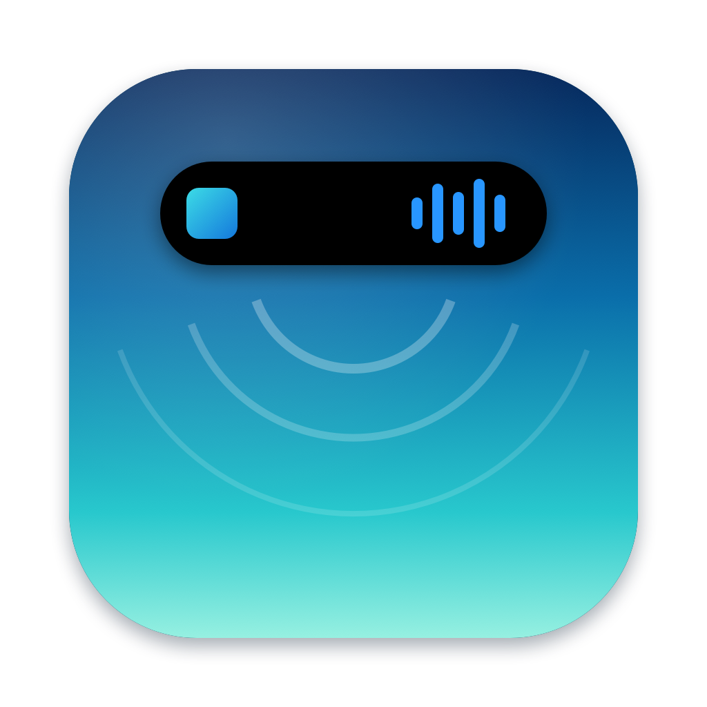

<p align="center"></p>

# Lagoon

แอปเล็กๆ ที่แสดง "Dynamic Island" ตรงรอยบากจอ Mac แสดงเพลงหรือคลิปที่กำลังเล่นจาก **Spotify**, **Apple Music** หรือ **YouTube** ใน Chrome / Brave / Safari

- ย่อ: ปกเพลง + แท่งเสียงขยับ
- เอาเมาส์ไปชี้: ขยายเป็นการ์ด มีปกเพลง ชื่อเพลง ศิลปิน แถบเวลา และปุ่ม ก่อนหน้า / เล่น-หยุด / ถัดไป
- กดที่ปกหรือชื่อเพลง: เปิดหน้าเพลงนั้นใน Spotify / Music
- ถอด Bluetooth (AirPods, หูฟัง, เมาส์, คีย์บอร์ด): แสดงแจ้งเตือน 3 วินาที
- หยุดเพลง: island ค่อยๆ จางหายหลัง 3 วินาที กดเล่นต่อแล้วจะกลับมาเอง
- ไอคอนเล็กๆ บอกว่ามีอุปกรณ์ Bluetooth อะไรต่ออยู่ พร้อม % แบต (ชี้ค้างเพื่อดูแบตหูซ้าย/ขวา/กล่อง)
- เปิดเองอัตโนมัติตอนล็อกอิน (ปิดได้ที่ System Settings → General → Login Items)

## ติดตั้ง (สำหรับคนทั่วไป)

1. โหลด `Lagoon-x.y.z.zip` ล่าสุดจาก [Releases](https://github.com/Gameinwza/mac-dynamic-island/releases/latest) แล้วแตกไฟล์
2. ลาก `Lagoon.app` ไปไว้ใน **Applications**
3. แอปยังไม่ได้ notarize กับ Apple เปิดครั้งแรก macOS จะเตือนว่าตรวจสอบนักพัฒนาไม่ได้ ให้ไปที่
   **System Settings → Privacy & Security** แล้วกด **Open Anyway** (ทำครั้งเดียว)
   หรือรันใน Terminal: `xattr -dr com.apple.quarantine /Applications/Lagoon.app`
4. กดอนุญาตเมื่อแอปขอควบคุม Spotify / Music / เบราว์เซอร์

ต้องใช้ macOS 14 ขึ้นไป รองรับทั้ง Apple silicon และ Intel

ออกเวอร์ชันใหม่ (เจ้าของ repo): `./release.sh 1.0.1`

## Build & run

```sh
./build.sh
cp -R Lagoon.app /Applications/
open /Applications/Lagoon.app
```

ครั้งแรกที่เปิดเพลง macOS จะถามสิทธิ์ให้ควบคุม Spotify/Music ให้กด OK
(ตั้งค่าภายหลังได้ที่ System Settings → Privacy & Security → Automation)

ปิดแอป: `pkill Lagoon`

## YouTube

ต้องเปิดให้เบราว์เซอร์รับ JavaScript จาก AppleScript ก่อน ไม่งั้นจะเห็นแค่ชื่อคลิป ไม่มีแถบเวลาและปุ่มควบคุม

- **Chrome / Brave:** เมนู View → Developer → Allow JavaScript from Apple Events
- **Safari:** Settings → Advanced → เปิด "Show features for web developers" แล้วไปที่เมนู Develop → Allow JavaScript from Apple Events

## อัปเดตอัตโนมัติ

```sh
./install-autoupdate.sh
```

เช็ก `main` ตอนล็อกอินและทุก 30 นาที ถ้ามีโค้ดใหม่จะ build และติดตั้งแอปใหม่ให้เอง (log อยู่ที่ `~/Library/Logs/DynamicIsland-update.log`)

## ข้อจำกัด

- รองรับ YouTube เฉพาะหน้าดูคลิป (`youtube.com/watch`) ใน Chrome, Brave และ Safari
- ต้องใช้ macOS 14 ขึ้นไป

## ตั้งค่า

คลิกขวาที่เกาะ แล้วเลือก **ตั้งค่า…** หรือเปิดแอป Lagoon ซ้ำอีกครั้ง

ตั้งได้: สีคลื่นเสียง, เวลาซ่อนหลังหยุดเพลง, เปิด/ปิด YouTube, แจ้งเตือน Bluetooth หลุด, ไอคอนอุปกรณ์ และเปิดเองตอนเข้าเครื่อง
ปุ่ม **คืนค่าเริ่มต้น** จะตั้งทุกอย่างกลับเป็นค่าเดิม
